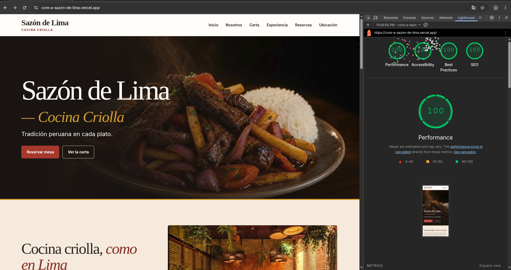

# Sazón de Lima | Cocina Criolla

Core A V2.0 es una landing de portafolio para un restaurante peruano ficticio. La carta presenta seis platos criollos con precios referenciales. El formulario permite probar la navegación y la validación de una reserva.

[Demo pública de la versión estable](https://core-a-sazon-de-lima.vercel.app/) · [Repositorio](https://github.com/Diego4422/core-a-sazon-de-lima)

## Arquitectura

- HTML5 semántico con SEO local, Open Graph, imágenes responsivas y validación nativa.
- Tailwind CSS v4.3.5 y CLI oficial. `css/input.css` define los tokens de marca mediante `@theme`, registra `index.html` y `js/main.js` como fuentes y aplica el reset de `@tailwindcss/forms` a los campos de reservas.
- JavaScript nativo para el menú, los avisos por campo y el estado de validación. Los errores se asocian mediante `aria-invalid` y `aria-describedby`. El aviso general se anuncia como alerta. Con JavaScript desactivado, se mantiene la navegación y la validación nativa, seguida del aviso en la página. El formulario omite los nombres de los campos para que la petición local de respaldo carezca de sus valores.
- La interfaz responde a la preferencia de tema del sistema y a movimiento reducido. Emplea fuentes del sistema. La portada precarga el mismo conjunto WebP que selecciona la etiqueta `picture`.

Referencias de implementación. [Tailwind CLI](https://tailwindcss.com/docs/installation/tailwind-cli) · [Plugin oficial de formularios](https://github.com/tailwindlabs/tailwindcss-forms)

## Estructura

```text
sazon-de-lima/
├── index.html
├── package.json
├── package-lock.json
├── assets/img/     # WebP, PNG, favicon SVG y tarjeta social JPEG
├── css/
│   ├── input.css   # Fuente de Tailwind, tokens y ajustes locales
│   └── output.css  # CSS minificado para producción
├── js/main.js
└── docs/          # Verificación, ficha freelance y auditoría histórica
```

## Revisar en Linux

Desde la raíz, con Node.js, npm y Python 3 disponibles, ejecuta:

```bash
npm ci
npm run build:css
python3 -m http.server 8000 --bind 127.0.0.1
```

Abre [http://127.0.0.1:8000/](http://127.0.0.1:8000/). Si solo quieres revisar la entrega, puedes iniciar el servidor directamente, ya que `css/output.css` está incluido. Durante la edición, ejecuta `npm run dev:css` en una segunda terminal para vigilar los cambios. Antes de preparar una revisión, vuelve a generar el archivo minificado con `npm run build:css`. `package-lock.json` fija las dependencias y `node_modules/` queda excluido del repositorio.

## Activos e identidad

Las diez fotografías conservan su WebP y su respaldo PNG. La portada usa el lomo saltado humeante con prioridad alta. Las otras nueve fotos se cargan de forma diferida y conservan sus dimensiones declaradas. La cabecera combina la marca tipográfica con el SVG existente, `assets/img/favicon.svg`. Se conserva `assets/img/og-image.jpg` y su URL Open Graph absoluta. Un futuro SVG exclusivo para el logotipo puede sustituir el icono decorativo dentro del enlace de marca.

## Publicación manual y lanzamiento

La V2.0 genera un sitio estático listo para servir desde la raíz. La publicación existente de Vercel puede seguir sirviendo `index.html` y `css/output.css` directamente. El director del proyecto controla Git, GitHub y Vercel.

La documentación reutilizable del Bloque 2 incluye los formatos de oferta, un checklist de inicio y una estimación con un margen del 25 %. [Ficha freelance](docs/servicio-freelance.md) · [Propuesta comercial](docs/propuesta-comercial.pdf)

## Verificación de V2.0

- La CLI oficial generó un `css/output.css` minificado de **27 630 bytes**. Recompilar tras retirar las tres hojas anteriores produjo el mismo SHA-256.
- Chromium 156 pasó a 320, 375, 768, 1024 y 1440 px en claro y oscuro. Firefox 159 y WebKitGTK 2.54.2 pasaron a 320, 768 y 1440 px. En los anchos probados se verificaron la cuadrícula y la ausencia de scroll horizontal.
- Se verificaron las seis anclas, el manejo del menú con teclado, la validación y los avisos del formulario, el comportamiento sin JavaScript y la preferencia de movimiento reducido. axe-core 4.14.0 no reportó infracciones en las reglas WCAG A/AA ejecutadas en ninguno de los dos temas.
- Las 26 rutas locales comprobadas respondieron HTTP 200. Nu HTML Checker produjo cero avisos o errores y Chromium registró cero mensajes de error o advertencia en consola.
- La simulación con una paleta de prueba y el formulario antes de la carta conservó la referencia por ancla y la validación. Se ejecutó en el navegador, sobre el DOM y los tokens en memoria.

| Lighthouse 13.6.0 móvil | Puntuación |
|---|---:|
| Rendimiento | 100 |
| Accesibilidad | 100 |
| Buenas prácticas | 100 |
| SEO | 100 |

La ejecución local registró LCP de 1,46 s y CLS de 0. [Evidencia de verificación](docs/verificacion-v2.0.json)

### Errores corregidos

- Se renombró el token tipográfico de portada a `--text-display`. `text-hero` coincidía con el nombre de un token de color y la portada perdía tamaño y contraste.
- Se integró el reset `form-input` en la misma regla que aplica los tokens de los campos. Esto recuperó los colores de marca y el contorno de foco.
- El menú móvil y su versión sin JavaScript comparten una cuadrícula de tres columnas. El contenido sigue en el flujo en la versión sin JavaScript y las anclas se desplazan con el espacio que ocupa el encabezado.

El repositorio carece de un prototipo Figma de referencia. La revisión visual se hizo con capturas del sitio renderizado en claro y oscuro.

## Auditoría histórica de V1.5

El siguiente registro histórico corresponde a una ejecución móvil de la versión estable anterior. Registró 100 en rendimiento, accesibilidad, buenas prácticas y SEO.


